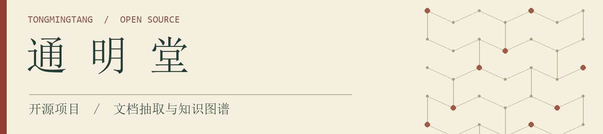

# 通明堂开源 · GraphRAG 知识库

通明堂官方开源仓库。这个项目把文档中的人物、概念和关系整理成知识图谱，支持结合原文出处查询答案。

[中文使用说明](#中文) · [English guide](#english) · [问题反馈](https://github.com/zkfws123/langextract_rag/issues) · [MIT 许可证](LICENSE)

---

<a name="english"></a>

## 🌟 Overview

A powerful **GraphRAG (Graph-based Retrieval Augmented Generation)** knowledge base system that combines structured knowledge extraction, vector search, and knowledge graph for intelligent question answering.

### Key Features

- 🤖 **Intelligent Knowledge Extraction**: Uses LLM-powered extraction to identify entities and relationships from documents
- 🔍 **Hybrid Retrieval**: Combines vector similarity search and graph traversal for accurate answers
- 📊 **Knowledge Graph**: Builds entity-relationship networks with precise source traceability
- 💬 **Evidence-Based Q&A**: LangGraph agent provides answers with cited evidence
- 🎨 **Modern UI**: Streamlit-based interface with document preview, graph visualization, and interactive chat
- 🔌 **Flexible LLM Support**: Works with OpenAI, DeepSeek, Google Gemini, and custom OpenAI-compatible APIs

### Architecture

```
┌─────────────────────────────────────────────────────────────┐
│                     Streamlit UI Layer                       │
│  (Document Upload, Preview, Chat, Graph Visualization)      │
└─────────────────────────────────────────────────────────────┘
                              │
┌─────────────────────────────────────────────────────────────┐
│                    LangGraph Agent                           │
│  (Hybrid Search Tool, Vector Tool, Graph Tool)              │
└─────────────────────────────────────────────────────────────┘
                              │
        ┌─────────────────────┴─────────────────────┐
        │                                           │
┌───────▼────────┐                        ┌────────▼────────┐
│  Vector Store  │                        │  Knowledge Graph │
│   (ChromaDB)   │                        │  (In-Memory)     │
└───────▲────────┘                        └────────▲────────┘
        │                                           │
        └─────────────────────┬─────────────────────┘
                              │
┌─────────────────────────────────────────────────────────────┐
│              Knowledge Extraction Pipeline                   │
│  (LangExtract + LLM → Entities + Relations)                 │
└─────────────────────────────────────────────────────────────┘
                              │
┌─────────────────────────────────────────────────────────────┐
│                   Document Parser                            │
│         (MinerU OCR / Local PDF Parser)                      │
└─────────────────────────────────────────────────────────────┘
```

---

## 🚀 Quick Start

### Prerequisites

- Python 3.10+
- API Keys for:
  - LLM service (OpenAI / DeepSeek / Gemini)
  - Embedding service (DashScope / OpenAI)
  - (Optional) MinerU OCR service

### Installation

1. **Clone the repository**

```bash
git clone https://github.com/zkfws123/langextract_rag.git
cd langextract_rag
```

2. **Install dependencies**

```bash
pip install -r requirements.txt
```

3. **Configure environment variables**

Copy `.env.example` to `.env` and fill in your API keys:

```bash
cp .env.example .env
```

Edit `.env`:

```bash
# OpenAI API Configuration
OPENAI_API_KEY=your_openai_api_key_here
OPENAI_BASE_URL=https://api.openai.com/v1
OPENAI_MODEL=gpt-4o

# DeepSeek API Configuration
DEEPSEEK_API_KEY=your_deepseek_api_key_here
DEEPSEEK_BASE_URL=https://api.deepseek.com/v1
DEFAULT_MODEL=deepseek-chat

# DashScope (Aliyun) for Embeddings
DASHSCOPE_API_KEY=your_dashscope_api_key_here
DASHSCOPE_BASE_URL=https://dashscope.aliyuncs.com/compatible-mode/v1
EMBEDDING_MODEL=text-embedding-v4

# Active LLM Selection
ACTIVE_LLM=deepseek
```

4. **Run the application**

```bash
streamlit run src/ui/app.py
```

The app will open at http://localhost:8501

---

## 📖 Usage

### 1. Create a Knowledge Base

- Click "➕ 新建知识库" in the sidebar
- Enter a name and description
- Select extraction configuration (General or Domain-specific)

### 2. Upload Documents

- Select your knowledge base
- Upload PDF files
- Choose OCR method (MinerU Cloud / Local)
- Click "开始处理" to extract knowledge

### 3. Ask Questions

- Go to the "💬 智能问答" tab
- Type your question
- The agent will search the knowledge base and provide evidence-based answers

### 4. Explore Knowledge

- **📄 文档预览**: View extracted markdown with page navigation
- **🕸️ 知识图谱**: Interactive graph visualization
- **📋 提取结果**: Browse and edit extracted entities
- **📊 知识洞察**: View statistics and analytics

---

## 🔧 Configuration

### LLM Selection

The system supports multiple LLM providers. Configure via UI or environment variables:

- **OpenAI**: `ACTIVE_LLM=openai`
- **DeepSeek**: `ACTIVE_LLM=deepseek` (default, cost-effective)
- **Google Gemini**: `ACTIVE_LLM=gemini`
- **Custom API**: `ACTIVE_LLM=custom` (any OpenAI-compatible endpoint)

### UI Configuration

Access settings in the sidebar:

- **🔑 API 配置**: Configure API keys and endpoints directly in the UI
- **🤖 LLM 模型**: Switch between different LLM providers
- **⚙️ 知识提取配置**: Customize extraction prompts and parallel processing

### Extraction Customization

Create custom extraction prompts in `src/configs/prompts/`:

```python
PROMPT = """
Extract the following information from the text:
1. Key concepts
2. Definitions
3. Relationships
"""

EXAMPLES = [
    # Add examples here
]
```

---

## 🏗️ Project Structure

```
langextract_rag/
├── src/
│   ├── agents/          # LangGraph agent and tools
│   ├── configs/         # Extraction prompts and configs
│   ├── graph/           # Knowledge graph models and storage
│   ├── knowledge_base/  # KB management service
│   ├── parsers/         # Document parsing and extraction
│   ├── retrieval/       # Vector store (ChromaDB)
│   └── ui/              # Streamlit interface
├── outputs/
│   ├── knowledge_bases/ # KB storage (documents, graphs)
│   └── logs/            # Agent chat logs
├── .env.example         # Environment variable template
├── requirements.txt     # Python dependencies
└── README.md            # This file
```

---

## 🤝 Contributing

Contributions are welcome! Please feel free to submit a Pull Request.

1. Fork the repository
2. Create your feature branch (`git checkout -b feature/AmazingFeature`)
3. Commit your changes (`git commit -m 'Add some AmazingFeature'`)
4. Push to the branch (`git push origin feature/AmazingFeature`)
5. Open a Pull Request

---

## 📄 License

This project is licensed under the MIT License - see the [LICENSE](LICENSE) file for details.

---

## 🙏 Acknowledgments

- [LangExtract](https://github.com/langextract/langextract) - Structured extraction framework
- [LangChain](https://github.com/langchain-ai/langchain) - LLM application framework
- [ChromaDB](https://github.com/chroma-core/chroma) - Vector database
- [Streamlit](https://github.com/streamlit/streamlit) - UI framework
- [MinerU](https://mineru.net) - PDF OCR service

---

## 📧 Contact

- GitHub: [@zkfws123](https://github.com/zkfws123)
- Project Link: [https://github.com/zkfws123/langextract_rag](https://github.com/zkfws123/langextract_rag)

---

<a name="中文"></a>

## 🌟 项目简介

一个强大的 **GraphRAG（基于图的检索增强生成）** 知识库系统，结合结构化知识提取、向量检索和知识图谱，实现智能问答。

### 核心特性

- 🤖 **智能知识提取**：使用 LLM 驱动的提取引擎，从文档中识别实体和关系
- 🔍 **混合检索**：结合向量相似度搜索和图谱遍历，提供精准答案
- 📊 **知识图谱**：构建实体关系网络，支持精确的来源追溯
- 💬 **证据驱动问答**：LangGraph Agent 提供带引用证据的答案
- 🎨 **现代化界面**：基于 Streamlit 的交互界面，支持文档预览、图谱可视化和智能对话
- 🔌 **灵活的 LLM 支持**：支持 OpenAI、DeepSeek、Google Gemini 和自定义 OpenAI 兼容 API

### 系统架构

```
┌─────────────────────────────────────────────────────────────┐
│                     Streamlit UI 层                          │
│  (文档上传、预览、对话、图谱可视化)                          │
└─────────────────────────────────────────────────────────────┘
                              │
┌─────────────────────────────────────────────────────────────┐
│                    LangGraph Agent                           │
│  (混合检索工具、向量工具、图谱工具)                          │
└─────────────────────────────────────────────────────────────┘
                              │
        ┌─────────────────────┴─────────────────────┐
        │                                           │
┌───────▼────────┐                        ┌────────▼────────┐
│   向量存储     │                        │    知识图谱     │
│   (ChromaDB)   │                        │   (内存存储)    │
└───────▲────────┘                        └────────▲────────┘
        │                                           │
        └─────────────────────┬─────────────────────┘
                              │
┌─────────────────────────────────────────────────────────────┐
│                  知识提取流水线                              │
│  (LangExtract + LLM → 实体 + 关系)                          │
└─────────────────────────────────────────────────────────────┘
                              │
┌─────────────────────────────────────────────────────────────┐
│                     文档解析器                               │
│         (MinerU OCR / 本地 PDF 解析器)                      │
└─────────────────────────────────────────────────────────────┘
```

---

## 🚀 快速开始

### 环境要求

- Python 3.10+
- API 密钥：
  - LLM 服务（OpenAI / DeepSeek / Gemini）
  - Embedding 服务（DashScope / OpenAI）
  - （可选）MinerU OCR 服务

### 安装步骤

1. **克隆仓库**

```bash
git clone https://github.com/zkfws123/langextract_rag.git
cd langextract_rag
```

2. **安装依赖**

```bash
pip install -r requirements.txt
```

3. **配置环境变量**

复制 `.env.example` 为 `.env` 并填入您的 API 密钥：

```bash
cp .env.example .env
```

编辑 `.env`：

```bash
# OpenAI API 配置
OPENAI_API_KEY=your_openai_api_key_here
OPENAI_BASE_URL=https://api.openai.com/v1
OPENAI_MODEL=gpt-4o

# DeepSeek API 配置
DEEPSEEK_API_KEY=your_deepseek_api_key_here
DEEPSEEK_BASE_URL=https://api.deepseek.com/v1
DEFAULT_MODEL=deepseek-chat

# DashScope (阿里云) Embedding 配置
DASHSCOPE_API_KEY=your_dashscope_api_key_here
DASHSCOPE_BASE_URL=https://dashscope.aliyuncs.com/compatible-mode/v1
EMBEDDING_MODEL=text-embedding-v4

# 激活的 LLM 选择
ACTIVE_LLM=deepseek
```

4. **运行应用**

```bash
streamlit run src/ui/app.py
```

应用将在 http://localhost:8501 打开

---

## 📖 使用指南

### 1. 创建知识库

- 在侧边栏点击"➕ 新建知识库"
- 输入名称和描述
- 选择提取配置（通用或领域专用）

### 2. 上传文档

- 选择您的知识库
- 上传 PDF 文件
- 选择 OCR 方法（MinerU 云端 / 本地）
- 点击"开始处理"提取知识

### 3. 智能问答

- 进入"💬 智能问答"标签页
- 输入您的问题
- Agent 将搜索知识库并提供带证据的答案

### 4. 探索知识

- **📄 文档预览**：查看提取的 Markdown 文档，支持分页导航
- **🕸️ 知识图谱**：交互式图谱可视化
- **📋 提取结果**：浏览和编辑提取的实体
- **📊 知识洞察**：查看统计数据和分析

---

## 🔧 配置说明

### LLM 选择

系统支持多个 LLM 提供商。可通过 UI 或环境变量配置：

- **OpenAI**: `ACTIVE_LLM=openai`
- **DeepSeek**: `ACTIVE_LLM=deepseek`（默认，性价比高）
- **Google Gemini**: `ACTIVE_LLM=gemini`
- **自定义 API**: `ACTIVE_LLM=custom`（任何 OpenAI 兼容端点）

### UI 配置

在侧边栏访问设置：

- **🔑 API 配置**：直接在 UI 中配置 API 密钥和端点
- **🤖 LLM 模型**：在不同 LLM 提供商之间切换
- **⚙️ 知识提取配置**：自定义提取提示词和并行处理

### 自定义提取

在 `src/configs/prompts/` 中创建自定义提取提示词：

```python
PROMPT = """
从文本中提取以下信息：
1. 关键概念
2. 定义
3. 关系
"""

EXAMPLES = [
    # 在此添加示例
]
```

---

## 🏗️ 项目结构

```
langextract_rag/
├── src/
│   ├── agents/          # LangGraph agent 和工具
│   ├── configs/         # 提取提示词和配置
│   ├── graph/           # 知识图谱模型和存储
│   ├── knowledge_base/  # 知识库管理服务
│   ├── parsers/         # 文档解析和提取
│   ├── retrieval/       # 向量存储 (ChromaDB)
│   └── ui/              # Streamlit 界面
├── outputs/
│   ├── knowledge_bases/ # 知识库存储（文档、图谱）
│   └── logs/            # Agent 对话日志
├── .env.example         # 环境变量模板
├── requirements.txt     # Python 依赖
└── README.md            # 本文件
```

---

## 🤝 贡献

欢迎贡献！请随时提交 Pull Request。

1. Fork 本仓库
2. 创建您的特性分支 (`git checkout -b feature/AmazingFeature`)
3. 提交您的更改 (`git commit -m 'Add some AmazingFeature'`)
4. 推送到分支 (`git push origin feature/AmazingFeature`)
5. 打开 Pull Request

---

## 📄 许可证

本项目采用 MIT 许可证 - 详见 [LICENSE](LICENSE) 文件。

---

## 🙏 致谢

- [LangExtract](https://github.com/langextract/langextract) - 结构化提取框架
- [LangChain](https://github.com/langchain-ai/langchain) - LLM 应用框架
- [ChromaDB](https://github.com/chroma-core/chroma) - 向量数据库
- [Streamlit](https://github.com/streamlit/streamlit) - UI 框架
- [MinerU](https://mineru.net) - PDF OCR 服务

---

## 📧 联系方式

- GitHub: [@zkfws123](https://github.com/zkfws123)
- 项目链接: [https://github.com/zkfws123/langextract_rag](https://github.com/zkfws123/langextract_rag)

